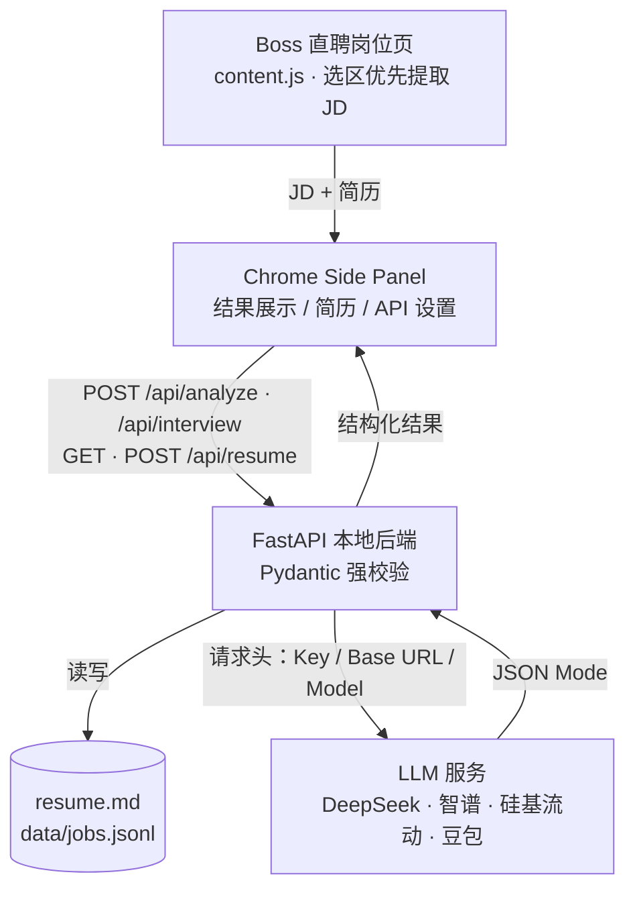

# BossCopilot

> 基于 Chrome Side Panel + 本地大模型的 Boss 直聘人机协同求职助手：在岗位页一键得到匹配度、短板、打招呼语与面试模拟题。

[](LICENSE)
[](extension/manifest.json)
[](backend/requirements.txt)

## ✨ 亮点

- **简历开箱即用**：侧边栏直接粘贴文本，或上传 `.pdf` / `.md` / `.txt`（PDF 由后端自动提取文字）。**隐私纯本地保存**，`backend/resume.md` 被 `.gitignore` 忽略，永不入库、不上传。
- **BYOK 与免费模型**：内置智谱 `glm-4-flash`、硅基流动、DeepSeek、豆包预设，选中即填好地址与模型。**没有付费 Key 也能用**——注册智谱或硅基流动拿免费额度即可开跑。
- **一键出 8 道面试题**：3 道深挖简历项目、3 道针对岗位短板、2 道业务场景设计，附答题结构。
- **批量市场趋势**：把积累的历史岗位读成「高频技能 Top 10 + 简历缺口 + 修改建议」报告。
- **不依赖打包工具**：插件是纯 HTML/CSS/JS，后端只有 5 个 Python 文件，克隆即用。

## 🏗 架构



请求头里的模型配置优先，缺哪项就用 `backend/.env` 的默认值补哪项。

## 🚀 快速开始（3 步）

### 1. 启动后端

```bash
cd backend
python -m venv .venv                                          # 首次
.venv\Scripts\python.exe -m pip install -r requirements.txt
.venv\Scripts\python.exe -m uvicorn main:app --reload --port 8000
```

`.env` 是**可选的**：不建也能跑，Key 在侧边栏「API 设置」里填。想固定默认配置就 `copy .env.example .env` 后填入 `DEEPSEEK_API_KEY`。
macOS / Linux 把 `.venv\Scripts\python.exe` 换成 `.venv/bin/python`。

### 2. 加载扩展

打开 `chrome://extensions` → 右上角开启「开发者模式」→「加载已解压的扩展程序」→ 选择本仓库的 `extension/` 目录。

### 3. 配简历，开跑

打开 Boss 直聘岗位详情页 → 点击工具栏的 BossCopilot 图标 → 展开「我的简历」，**粘贴或上传 PDF** → 回到页面点「分析当前岗位」。
抓不到 JD 时，先在页面上用鼠标选中 JD 文本，再点一次按钮。

## 🔑 自带 Key（BYOK）与免费模型

| 预设 | Base URL | 默认模型 | 说明 |
|---|---|---|---|
| 智谱清言 | `https://open.bigmodel.cn/api/paas/v4` | `glm-4-flash` | 有免费额度，推荐先用这个 |
| 硅基流动 | `https://api.siliconflow.cn/v1` | `Qwen/Qwen2.5-7B-Instruct` | 免费开源模型 |
| DeepSeek | `https://api.deepseek.com` | `deepseek-chat` | 默认，需账户余额 |
| 豆包 / 火山引擎 | `https://ark.cn-beijing.volces.com/api/v3` | 填接入点 ID（`ep-` 开头） | 注意不是模型名 |
| 自定义 | 任意 OpenAI 兼容地址 | 任意 | — |

「测试连接」会发一句 `hi` 验证 Key、地址与模型名，失败直接显示服务商的原始报错。

## 📡 接口

| 方法 | 路径 | 说明 |
|---|---|---|
| POST | `/api/analyze` | JD + 简历 → 匹配度、3 条优势、2-3 条短板、3 条打招呼语 |
| POST | `/api/interview` | JD + 简历 → 8 道面试题（3 / 3 / 2） |
| POST | `/api/test-connection` | 用请求头配置发 `hi` 探活，失败也返回 200 + 原文 |
| GET | `/api/resume` | 读取当前简历 |
| POST | `/api/resume` | 保存粘贴或微调后的简历 |
| POST | `/api/resume/upload` | 上传 `.pdf` / `.md` / `.txt` 并解析写入 |
| GET | `/api/health` | 自检：简历是否存在、密钥是否已配 |

服务默认只监听 `127.0.0.1:8000`，不对局域网暴露。

## 📊 市场趋势报告

```bash
.venv\Scripts\python.exe backend\market_report.py
```

读取 `backend/data/jobs.jsonl`（每次分析自动追加），并发抽取每条 JD 的技能标签，生成 `backend/data/market_report.md`：高频技能 Top 10、简历缺口对比、针对性修改建议。

## 🔒 隐私

| 数据 | 存放位置 | 是否入库 |
|---|---|---|
| 简历 | `backend/resume.md` | ❌ 已在 `.gitignore` |
| 岗位历史 / 报告 | `backend/data/` | ❌ 已在 `.gitignore` |
| API Key（后端默认） | `backend/.env` | ❌ 已在 `.gitignore` |
| API Key（侧边栏） | 浏览器 `chrome.storage.local` | 仅本机，不上传 |
| 分析结果 | 只在本机进程内传递 | 仅追加到本地 jsonl |

## 📄 License

[MIT](LICENSE)
