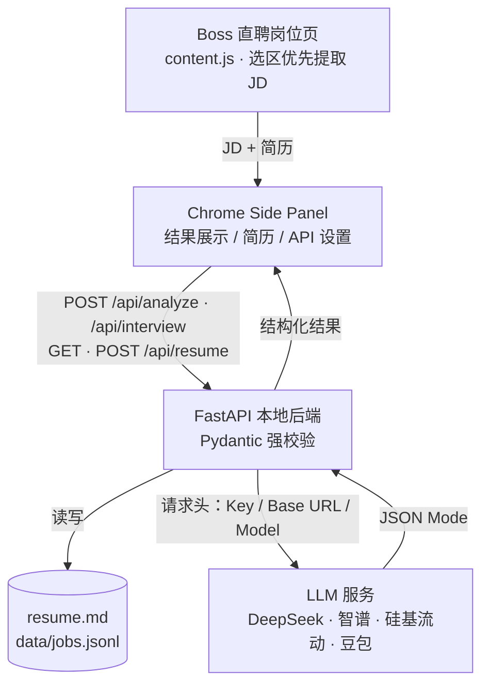

# BossCopilot

> 基于 Chrome Side Panel + 本地大模型的 Boss 直聘人机协同求职助手：在岗位页一键得到匹配度、短板、打招呼语与面试模拟题。

[](LICENSE)
[](extension/manifest.json)
[](backend/requirements.txt)

## ✨ 亮点

- **简历开箱即用**：侧边栏直接粘贴文本，或上传 `.pdf` / `.md` / `.txt`（PDF 由后端自动提取文字）。**隐私纯本地保存**，`backend/resume.md` 被 `.gitignore` 忽略，永不入库、不上传。
- **BYOK 与免费模型**：内置智谱 `glm-4-flash`、硅基流动、DeepSeek、豆包预设，选中即填好地址与模型。**没有付费 Key 也能用**——注册智谱或硅基流动拿免费额度即可开跑。
- **一键出 8 道面试题**：3 道深挖简历项目、3 道针对岗位短板、2 道业务场景设计，附答题结构。
- **聊天页智能回复**：在 Boss 聊天页点一下，读出最近对话，先把 HR 归入 6 类意图（索要资料 / 评估挂起 / 探薪资 / 约面试 / 婉拒 / 日常），再由 LangGraph 条件路由匹配对应的话术策略，给 3 条 1-2 句的短回复，可复制或一键填入输入框（**绝不自动发送**）。抓不到 DOM 时可手动粘贴兜底。
- **批量市场趋势**：把积累的历史岗位读成「高频技能 Top 10 + 简历缺口 + 修改建议」报告。
- **不依赖打包工具**：插件是纯 HTML/CSS/JS，后端只有 5 个 Python 文件，克隆即用。

## 🏗 架构



请求头里的模型配置优先，缺哪项就用 `backend/.env` 的默认值补哪项。

## 🚀 快速开始（3 步）

### 1. 启动后端

```bash
cd backend
python -m venv .venv                                          # 首次
.venv\Scripts\python.exe -m pip install -r requirements.txt
.venv\Scripts\python.exe -m uvicorn main:app --reload --port 8000
```

`.env` 是**可选的**：不建也能跑，Key 在侧边栏「API 设置」里填。想固定默认配置就 `copy .env.example .env` 后填入 `DEEPSEEK_API_KEY`。
macOS / Linux 把 `.venv\Scripts\python.exe` 换成 `.venv/bin/python`。

### 2. 加载扩展

打开 `chrome://extensions` → 右上角开启「开发者模式」→「加载已解压的扩展程序」→ 选择本仓库的 `extension/` 目录。

### 3. 配简历，开跑

打开 Boss 直聘岗位详情页 → 点击工具栏的 BossCopilot 图标 → 展开「我的简历」，**粘贴或上传 PDF** → 回到页面点「分析当前岗位」。
抓不到 JD 时，先在页面上用鼠标选中 JD 文本，再点一次按钮。

## 🔑 自带 Key（BYOK）与免费模型

| 预设 | Base URL | 默认模型 | 说明 |
|---|---|---|---|
| 智谱清言 | `https://open.bigmodel.cn/api/paas/v4` | `glm-4-flash` | 有免费额度，推荐先用这个 |
| 硅基流动 | `https://api.siliconflow.cn/v1` | `Qwen/Qwen2.5-7B-Instruct` | 免费开源模型 |
| DeepSeek | `https://api.deepseek.com` | `deepseek-chat` | 默认，需账户余额 |
| 豆包 / 火山引擎 | `https://ark.cn-beijing.volces.com/api/v3` | 填接入点 ID（`ep-` 开头） | 注意不是模型名 |
| 自定义 | 任意 OpenAI 兼容地址 | 任意 | — |

「测试连接」会发一句 `hi` 验证 Key、地址与模型名，失败直接显示服务商的原始报错。

## 📡 接口

| 方法 | 路径 | 说明 |
|---|---|---|
| POST | `/api/analyze` | JD + 简历 → 匹配度、3 条优势、2-3 条短板、3 条打招呼语 |
| POST | `/api/interview` | JD + 简历 → 8 道面试题（3 / 3 / 2） |
| POST | `/api/suggest-reply` | 聊天记录 → 6 类意图 + 潜台词 + 策略 + 3 条差异化短回复 |
| POST | `/api/test-connection` | 用请求头配置发 `hi` 探活，失败也返回 200 + 原文 |
| GET | `/api/resume` | 读取当前简历 |
| POST | `/api/resume` | 保存粘贴或微调后的简历 |
| POST | `/api/resume/upload` | 上传 `.pdf` / `.md` / `.txt` 并解析写入 |
| GET | `/api/health` | 自检：简历是否存在、密钥是否已配 |

服务默认只监听 `127.0.0.1:8000`，不对局域网暴露。

### 打招呼语的「生成 → 评审 → 重写」循环

`/api/analyze` 里的 3 条打招呼语由 LangGraph 状态机产出（`backend/agent_graph.py`）：

```
START → generate_node → review_node ─┬─ 通过，或已重写 2 次 → END
              ↑                     │
              └──── 不通过且还有额度 ─┘
```

- `generate_node`：首轮复用原来的完整分析（1 次调用拿到匹配度 / 优势 / 短板 / 3 条招呼语）；
  被打回后只重写 3 条招呼语，并逐条对应评审意见。
- `review_node`：先跑本地硬规则（条数、60 字上限、寒暄套话、重复），再让模型判"像不像 AI 套话、
  有没有接住 JD 硬性要求"，输出 `passed / score / issues / suggestions`。
- 条件边：通过或 `retry_count >= 2` 就收尾，否则带着修改意见打回重写。
- 接口出参与改造前完全一致，Chrome 插件无需改动。

终端里能直接看到每个节点的流转日志：

```bash
cd backend
.venv\Scripts\python.exe demo_reflection.py               # 真实跑一次
.venv\Scripts\python.exe demo_reflection.py --force-fail  # 强制首轮打回，看重写闭环
.venv\Scripts\python.exe -m pytest tests/test_agent_graph.py -v   # 离线回归，不花钱
```

### 聊天页智能回复（`/api/suggest-reply`）

侧边栏切到「帮我回复」，点一次「读取当前对话并推荐回复」：

1. 仅在点击时注入 `extension/chat.js` 读屏，不做后台监听、不轮询；
2. 读顶部岗位信息 + 最近 15 条消息，按 `hr / me / system` 分类；
3. 后端 `backend/reply_graph.py` 先判 6 类意图，再按意图走条件路由，用各自的约束生成 3 条 1-2 句短回复；
4. 侧边栏顶部先展示**意图徽章**（带颜色）与**一句话潜台词**，下面才是 3 张话术卡，可「复制」或「填入输入框」，**不会点击发送按钮**。

```
START → intent_node ─┬─ PENDING_REVIEW   → generate_hold_replies_node      ─┐
                     ├─ SCREENING        → generate_screening_replies_node ─┤
                     ├─ INTERVIEW_INVITE → generate_interview_replies_node  ─┼→ END
                     └─ 其余三类         → generate_etiquette_replies_node ─┘
```

意图只有 6 类，每类对应一套回复约束：

| 意图 | 中文徽章 | 回复约束 |
|---|---|---|
| `REQUEST_INFO` | 索要资料 | 立刻给到，最多补一个匹配点或确认下一步 |
| `PENDING_REVIEW` | 评估挂起 | ≤40 字短句收尾，最多 1 条带问号，绝不纠缠 |
| `SCREENING` | 薪资背景探询 | 锚定区间反问预算 / 能力对价 / 先聊岗位再谈薪 |
| `INTERVIEW_INVITE` | 约面试 | 直接确认时间 + 顺带问形式与轮次 |
| `REJECTED` | 婉拒 | 体面收尾，不辩解不追问 |
| `GENERAL` | 日常沟通 | 顺着聊，保持温度，不长篇自我介绍 |

`intent_node` 输出 `intent / confidence / analysis / strategy`：`analysis` 是一句潜台词（如"标准流程话术，大概率在走内部初筛，此时追问会显得急"），`strategy` 是一句行动建议，两者都会直接展示在侧边栏。模型输出解析不了时按关键词兜底判类，不额外调用模型。

成本固定 2 次模型调用；任一分支的回复字数超限、问号过多、出现套话或内容重复，都会带着原因重试，最多 3 次。

DOM 抓不到时（页面改版、聊天区虚拟滚动），侧边栏会自动展开「手动粘贴」，把 HR 最后一句话贴进去即可生成。

```bash
curl -X POST http://127.0.0.1:8000/api/suggest-reply -H "Content-Type: application/json" -d "{\"job_info\":{\"title\":\"AI 应用工程师\",\"company\":\"某公司\",\"salary\":\"20-30K\"},\"chat_history\":[{\"role\":\"hr\",\"content\":\"方便发份简历吗？\"}]}"
```

## 📊 市场趋势报告

```bash
.venv\Scripts\python.exe backend\market_report.py
```

读取 `backend/data/jobs.jsonl`（每次分析自动追加），并发抽取每条 JD 的技能标签，生成 `backend/data/market_report.md`：高频技能 Top 10、简历缺口对比、针对性修改建议。

## 🔌 MCP Server 集成

项目内置一个标准 [MCP](https://modelcontextprotocol.io/) Server（`mcp_server/server.py`），通过 **stdio** 传输，把本地的岗位分析历史与简历直接暴露给 Cursor、Claude Desktop、WorkBuddy 等主流 MCP 客户端。它**只读**，不会修改你的数据，也不额外发起网络请求。

### 安装依赖

```bash
backend\.venv\Scripts\python.exe -m pip install -r mcp_server\requirements.txt
```

### 可用的 4 个 Tool

| Tool | 参数 | 说明 |
|---|---|---|
| `list_saved_jobs` | `min_score=0`、`limit=20` | 列出分析过的岗位摘要（序号 / 岗位名 / 匹配分 / 时间），按分析时间倒序，可按最低分筛选（`limit` 上限 100） |
| `get_job_detail` | `keyword` | 按岗位名关键词搜索，返回完整 JD、匹配优势、短板与打招呼语；同名岗位多次分析时返回最新一条并列出其他命中 |
| `get_my_resume` | — | 返回当前 `backend/resume.md` 全文，未配置时提示先到插件里设置 |
| `get_job_stats` | — | 分析次数与去重岗位数、平均匹配度、最高分岗位、高频短板 Top 5 |

数据来自 `backend/data/jobs.jsonl` 与 `backend/resume.md`。路径按脚本自身位置推导，因此在任何工作目录下启动都能读到同一份数据。

### 接入 Cursor

在项目根目录创建 `.cursor/mcp.json`。仓库已提供模板 `.cursor/mcp.json.example`，复制改名即可：

```json
{
  "mcpServers": {
    "boss-copilot": {
      "type": "stdio",
      "command": "${workspaceFolder}/backend/.venv/Scripts/python.exe",
      "args": ["${workspaceFolder}/mcp_server/server.py"]
    }
  }
}
```

`${workspaceFolder}` 由 Cursor 解析为项目根目录，所以不用写死绝对路径。macOS / Linux 把 `Scripts/python.exe` 换成 `bin/python`。保存后重启 Cursor 或重新加载窗口，在 **Customize** 面板确认 `boss-copilot` 已启用。

> `.cursor/mcp.json` 已被 `.gitignore` 忽略，本地路径不会推到 GitHub；想分享配置请改 `.cursor/mcp.json.example`。

接好后可以直接在编辑器里问「我分析过哪些岗位」「这条 JD 我差在哪」「我的简历写了什么」。

## 🔒 隐私

| 数据 | 存放位置 | 是否入库 |
|---|---|---|
| 简历 | `backend/resume.md` | ❌ 已在 `.gitignore` |
| 岗位历史 / 报告 | `backend/data/` | ❌ 已在 `.gitignore` |
| API Key（后端默认） | `backend/.env` | ❌ 已在 `.gitignore` |
| API Key（侧边栏） | 浏览器 `chrome.storage.local` | 仅本机，不上传 |
| 分析结果 | 只在本机进程内传递 | 仅追加到本地 jsonl |

后端只接受来自扩展页面的跨域请求（CORS 限定 `chrome-extension://<id>`），并校验 `Host` 头必须是 `127.0.0.1` / `localhost` / `::1`。这样即使你在开着后端时访问了恶意网页，对方也读不到简历、消耗不了额度，DNS rebinding 同样被挡住。

## 🧪 开发与测试

```bash
.venv\Scripts\python.exe -m pip install -r requirements-dev.txt
.venv\Scripts\python.exe -m pytest backend/tests -v
```

安全回归测试覆盖 5 项：恶意来源读简历被拒、扩展来源放行、恶意预检被拒、非回环 Host 拒绝、健康检查不泄露本机路径。

## 📄 License

[MIT](LICENSE)
